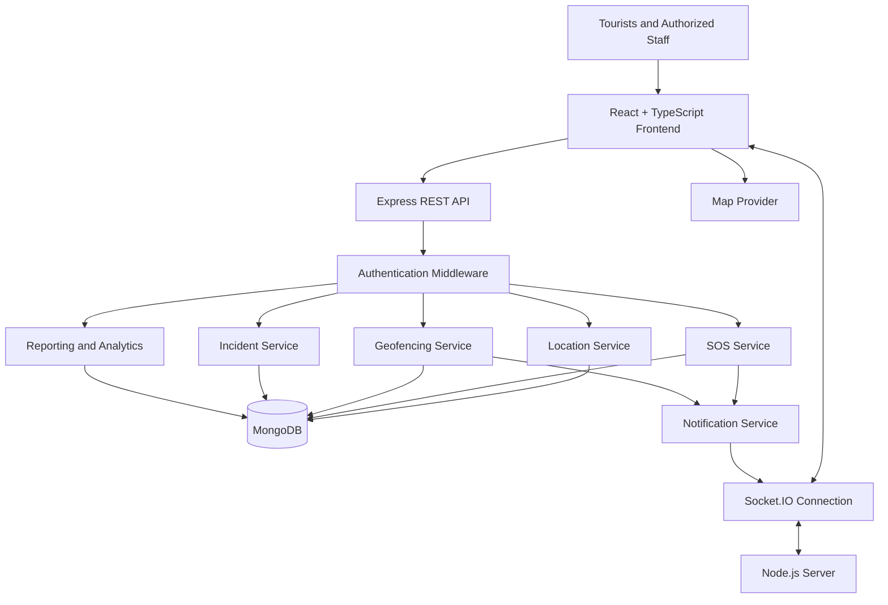
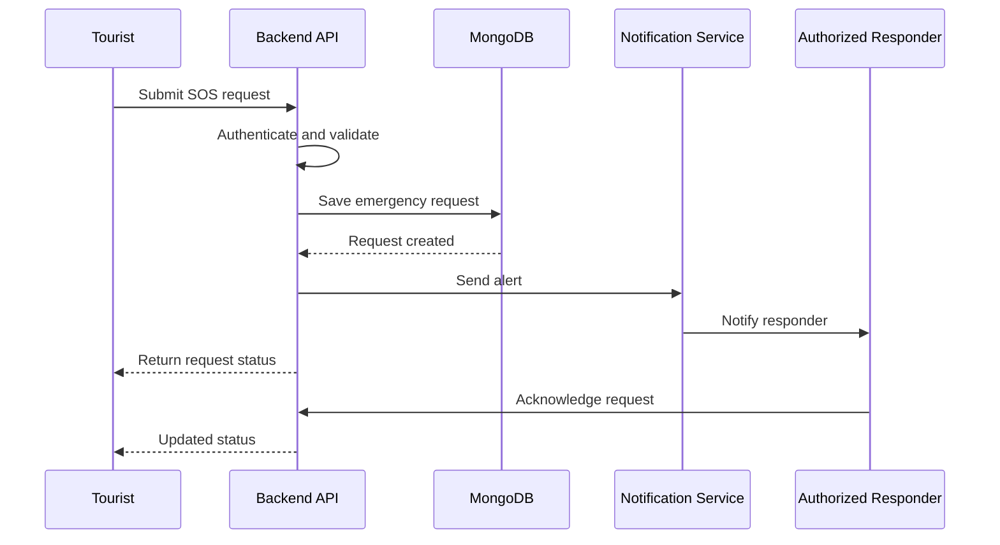

# 🛡️ SafeGuard | Tourist Monitoring System

### Smart Tourist Safety. Real-Time Monitoring. Faster Emergency Response.

> **Explore Safely. Travel Confidently. Stay Connected.**

<div align="center">


**A proposed smart tourism safety platform combining GPS tracking, interactive maps, emergency SOS, geofencing, incident management, and real-time monitoring.**

</div>

---

## 📖 1. Project Overview

**SafeGuard Tourist Monitoring System** is a smart tourism safety platform designed to help authorized personnel monitor tourist locations, respond to emergencies, identify potential safety risks, and coordinate assistance.

The platform brings together location tracking, safety heatmaps, emergency alerts, geofencing, incident reports, notifications, and administrative analytics in a unified interface.

Its goal is to support safer travel through timely information, reliable communication, and privacy-conscious monitoring.

### 🎯 Project Objectives

- Improve tourist safety and emergency response coordination.
- Provide location visibility with appropriate user consent.
- Enable SOS requests and incident reporting.
- Identify designated safety zones and geofence events.
- Visualize tourist activity and safety-related information.
- Deliver real-time updates to authorized users.
- Provide dashboards and reports for safety administrators.
- Build a modular foundation for future integrations.

---

## ✨ 2. Core Features

### 🗺️ Live GPS Tracking

- Display authorized tourist locations on an interactive map.
- Show location updates when tracking is enabled.
- View last reported location and update timestamp.
- Support multiple monitored users.
- Display relevant location and movement information.
- Handle unavailable GPS signals and stale location data.

**Privacy principle:** Location tracking should be transparent, purpose-limited, and based on appropriate consent and authorization.

### 🌍 Interactive Maps

- Map-based tourist visualization.
- Location markers and information panels.
- Safety zones and designated restricted areas.
- Geofence boundaries.
- Incident locations.
- Map filtering and navigation.
- Optional route visualization.

Potential integrations include Google Maps or Leaflet with a compatible map provider.

### 🔥 Safety Heatmap

- Visualize reported incident concentrations.
- Identify areas with repeated safety reports.
- Filter by incident category and time period.
- Support geographic risk analysis.
- Help administrators prioritize review and response.

Heatmaps should use verified data and clearly communicate uncertainty. A high incident concentration does not necessarily mean an area is inherently dangerous.

### 🚨 Emergency SOS

- Provide an accessible SOS interface.
- Submit an emergency request.
- Record request time and available location.
- Notify authorized responders.
- Display request status.
- Maintain an incident history.
- Support escalation workflows.

**Important:** SOS delivery must be confirmed by the backend and notification system. The interface should never claim that emergency assistance has been dispatched unless that status has been verified.

### 📍 Geofencing

- Define geographic safety zones.
- Detect entry into or exit from configured boundaries.
- Generate events when configured conditions are met.
- Notify authorized personnel when appropriate.
- Manage zone boundaries and rules.
- Maintain an auditable event history.

Geofencing depends on location accuracy, update frequency, device permissions, and backend processing.

### 🔔 Notifications

- SOS event notifications.
- Geofence alerts.
- Incident status updates.
- Administrative notifications.
- Delivery and acknowledgement status.
- Configurable notification preferences.

Real-time notifications require a configured backend and notification transport.

### 📊 Analytics Dashboard

- Tourist activity summaries.
- SOS request statistics.
- Incident category breakdowns.
- Geofence event summaries.
- Time-based activity trends.
- Safety report summaries.
- Administrative monitoring tools.

Analytics should distinguish verified events from estimates and incomplete data.

### 📝 Incident Reports

- Submit incident reports.
- Categorize reported events.
- Record timestamps and available locations.
- Track investigation status.
- Add authorized administrative notes.
- Generate reports for review.
- Maintain audit history.

### 👤 User and Admin Management

- User registration and authentication.
- User profile management.
- Role-based permissions.
- Authorized monitoring access.
- Administrative settings.
- Session management.
- Security-related audit logging.

---

## 🧭 3. Main Application Modules

| Module | Responsibility |
|---|---|
| Home | Project overview and entry points |
| Authentication | Login and registration |
| Dashboard | Monitoring overview |
| Live Tracking | Authorized GPS location display |
| Safety Heatmap | Geographic incident visualization |
| Emergency SOS | Emergency request workflow |
| Notifications | Alerts and status updates |
| Reports | Incident reports and summaries |
| Analytics | Safety and activity metrics |
| Profile | User information |
| Settings | Application preferences |
| Admin Panel | Authorized management tools |

---

## 🏗️ 4. System Architecture

The following diagram describes a proposed full-stack architecture based on the project structure.



### Architecture Principles

- Keep presentation, business logic, and data access separate.
- Authenticate and authorize requests on the backend.
- Validate incoming data before processing.
- Restrict access to sensitive location information.
- Handle disconnected clients and stale location updates.
- Use database indexes for frequent location and incident queries.
- Keep secrets and provider credentials on the server.
- Record security-sensitive actions in an audit trail.

This architecture is a design proposal. It does not establish that every service is already implemented.

---

## 💻 5. Technology Stack

### Frontend

| Technology | Purpose |
|---|---|
| React | Component-based user interface |
| TypeScript | Type-safe development |
| Vite | Development server and build tooling |
| Tailwind CSS | Responsive styling |
| Leaflet | Interactive maps |
| Google Maps API | Alternative mapping integration |
| Chart.js / Recharts | Data visualization |
| Socket.IO Client | Real-time event updates |

### Backend

| Technology | Purpose |
|---|---|
| Node.js | JavaScript runtime |
| Express.js | REST API framework |
| MongoDB | Document database |
| Mongoose | Optional MongoDB object modeling |
| Socket.IO | Real-time communication |
| JWT | Token-based authentication option |
| bcrypt | Password hashing |
| Helmet | HTTP security headers |
| express-rate-limit | Request rate limiting |

### Development and Deployment

| Technology | Purpose |
|---|---|
| Git | Version control |
| GitHub | Source code hosting |
| Vercel | Frontend deployment |
| Render | Backend deployment |
| Postman | API testing |

Use only the technologies and integrations actually configured in your application.

---

## 📂 6. Enterprise Project Structure

```text
SafeGuard-Tourist-Monitoring-System/
├── client/
│   ├── public/
│   ├── src/
│   │   ├── api/
│   │   ├── assets/
│   │   │   ├── images/
│   │   │   ├── icons/
│   │   │   └── animations/
│   │   ├── components/
│   │   │   ├── common/
│   │   │   ├── dashboard/
│   │   │   ├── maps/
│   │   │   ├── charts/
│   │   │   ├── forms/
│   │   │   ├── tables/
│   │   │   ├── notifications/
│   │   │   ├── emergency/
│   │   │   └── ui/
│   │   ├── pages/
│   │   │   ├── Home/
│   │   │   ├── Login/
│   │   │   ├── Register/
│   │   │   ├── Dashboard/
│   │   │   ├── LiveTracking/
│   │   │   ├── SafetyHeatmap/
│   │   │   ├── SOS/
│   │   │   ├── Reports/
│   │   │   ├── Analytics/
│   │   │   ├── Notifications/
│   │   │   ├── Profile/
│   │   │   ├── Settings/
│   │   │   └── Admin/
│   │   ├── context/
│   │   ├── hooks/
│   │   ├── layouts/
│   │   ├── routes/
│   │   ├── services/
│   │   ├── store/
│   │   ├── types/
│   │   ├── utils/
│   │   ├── constants/
│   │   ├── styles/
│   │   ├── App.tsx
│   │   └── main.tsx
│   ├── package.json
│   └── vite.config.ts
├── server/
│   ├── config/
│   ├── controllers/
│   ├── middleware/
│   ├── models/
│   ├── routes/
│   ├── services/
│   ├── repositories/
│   ├── validators/
│   ├── database/
│   ├── sockets/
│   ├── helpers/
│   ├── utils/
│   ├── uploads/
│   ├── logs/
│   ├── tests/
│   ├── app.js
│   ├── server.js
│   └── package.json
├── docs/
│   ├── API.md
│   ├── Architecture.md
│   ├── Database.md
│   ├── Deployment.md
│   └── UserGuide.md
├── screenshots/
├── .github/
├── .env.example
├── package.json
├── README.md
└── LICENSE
```

Adapt this structure to match the files that actually exist in your repository.

---

## ⚙️ 7. Getting Started

### Prerequisites

- Node.js and npm.
- Git.
- MongoDB local installation or a configured MongoDB service.
- A code editor such as Visual Studio Code.

### Step 1: Clone the Repository

```bash
git clone YOUR_GITHUB_REPOSITORY_URL
cd SafeGuard-Tourist-Monitoring-System
```

Replace the placeholder with your actual repository URL.

### Step 2: Install Root Dependencies

If the root `package.json` defines the required scripts:

```bash
npm install
```

### Step 3: Install Frontend Dependencies

```bash
cd client
npm install
```

### Step 4: Install Backend Dependencies

Open another terminal:

```bash
cd server
npm install
```

### Step 5: Configure Environment Variables

Create the backend `.env` file using the required variables described below.

### Step 6: Start the Backend

From the `server` directory, run the start command configured in `server/package.json`, for example:

```bash
npm run dev
```

### Step 7: Start the Frontend

From the `client` directory:

```bash
npm run dev
```

Open the local URL shown by Vite, commonly `http://localhost:5173`.

The exact commands depend on the scripts configured in each `package.json`.

---

## 🔐 8. Environment Variables

Example backend `.env.example`:

```env
NODE_ENV=development
PORT=5000

MONGO_URI=mongodb://localhost:27017/safeguard

JWT_SECRET=replace_with_a_long_random_secret

APP_URL=http://localhost:5173
```

Example frontend `.env.example`:

```env
VITE_API_BASE_URL=http://localhost:5000/api
```

Add map-provider variables only if your chosen integration requires them.

### Environment Security

- Never commit real `.env` files.
- Never put database credentials or JWT signing secrets in frontend variables.
- Use separate development and production secrets.
- Configure allowed origins explicitly.
- Rotate exposed credentials immediately.
- Do not log passwords, tokens, or unnecessary precise location data.

---

## 🔌 9. API Modules

The following is a proposed REST API organization.

| Module | Example Endpoints | Purpose |
|---|---|---|
| Authentication | `/api/auth` | Login, registration, sessions |
| Users | `/api/users` | User profiles and permissions |
| Tourists | `/api/tourists` | Tourist records |
| Locations | `/api/locations` | Authorized location updates |
| SOS | `/api/sos` | Emergency requests and status |
| Geofencing | `/api/geofences` | Zone configuration and events |
| Incidents | `/api/incidents` | Incident reporting and review |
| Notifications | `/api/notifications` | Notification history |
| Analytics | `/api/analytics` | Aggregated safety metrics |
| Dashboard | `/api/dashboard` | Overview data |
| Reports | `/api/reports` | Report generation |
| Admin | `/api/admin` | Restricted administration |

These routes are examples, not confirmed live endpoints.

### Example SOS Workflow



A successful API response should distinguish between a request being recorded, a notification being delivered, and a responder acknowledging it.

---

## 🗄️ 10. Database Collections

Proposed MongoDB collections:

| Collection | Purpose |
|---|---|
| `Users` | User identities and roles |
| `Tourists` | Tourist profiles and preferences |
| `Locations` | Authorized location records |
| `SOS_Requests` | Emergency requests and status |
| `GeoFences` | Geographic zones and rules |
| `Incidents` | Reported safety events |
| `Notifications` | Notification status and history |
| `Reports` | Generated reports and metadata |
| `ActivityLogs` | Security and activity events |
| `Admins` | Administrative permissions |
| `Sessions` | Session information, if persisted |

### Data Design Considerations

- Add indexes for frequent queries.
- Use geospatial indexes for geographic queries.
- Validate document structures.
- Apply retention rules to sensitive location records.
- Restrict access based on role and purpose.
- Avoid duplicate emergency requests where possible.
- Store timestamps consistently.
- Use synthetic data during development and demonstrations.

---

## 🔒 11. Security Layer

Recommended controls include:

- JWT authentication or secure session-based authentication.
- Password hashing with bcrypt.
- Protected routes and server-side authorization.
- Role-based access control.
- Input validation.
- CORS configuration.
- Helmet security headers.
- Rate limiting.
- Secure environment variable handling.
- Centralized error handling.
- Audit logging for sensitive actions.
- File upload validation.
- Database access controls.

### Location Privacy

Location information is sensitive personal data. The system should:

- Obtain appropriate consent before tracking.
- Explain when tracking is active and why.
- Limit access to authorized personnel.
- Collect only the data needed for the stated purpose.
- Define retention and deletion policies.
- Protect location data in transit and at rest.
- Provide clear procedures for access revocation.

Do not present the system as a substitute for official emergency services.

---

## 🧪 12. Testing Strategy

Suggested testing layers:

| Test Type | Purpose |
|---|---|
| Unit Testing | Validate individual functions |
| API Testing | Check endpoint behavior |
| Integration Testing | Verify database and service interactions |
| UI Testing | Validate application workflows |
| Real-Time Testing | Check Socket.IO event handling |
| Security Testing | Review authentication and authorization |
| Performance Testing | Assess behavior under load |

### Essential Test Scenarios

- [ ] Login and registration validation.
- [ ] Protected route access.
- [ ] Authorized location updates.
- [ ] GPS permission denial.
- [ ] Stale location handling.
- [ ] SOS creation and acknowledgement.
- [ ] Geofence entry and exit.
- [ ] Notification delivery failures.
- [ ] Unauthorized access prevention.
- [ ] Dashboard and report accuracy.
- [ ] Mobile and desktop responsiveness.

Configure the relevant testing dependencies and scripts before running tests.

---

## 🚀 13. Deployment

### Frontend: Vercel

1. Push the project to GitHub.
2. Import the repository into Vercel.
3. Configure the root directory as `client`.
4. Set the build command to `npm run build`.
5. Set the output directory to `dist`.
6. Configure `VITE_API_BASE_URL` for the deployed backend.
7. Deploy and test the production interface.

### Backend: Render

1. Create a web service from the repository.
2. Configure the root directory as `server`.
3. Set the build and start commands from `server/package.json`.
4. Configure MongoDB connectivity.
5. Add server-side environment variables.
6. Configure allowed frontend origins.
7. Verify health checks, logs, and API behavior.

### Production Checklist

- [ ] HTTPS enabled.
- [ ] Secrets configured securely.
- [ ] Database access restricted.
- [ ] Authentication and permissions tested.
- [ ] Location consent and retention policies documented.
- [ ] SOS and notification failure handling verified.
- [ ] Backups and monitoring configured.

---

## 🗺️ 14. Future Roadmap

Potential enhancements, subject to implementation:

- [ ] Improve live tracking reliability.
- [ ] Add configurable geofencing rules.
- [ ] Add acknowledged SOS escalation workflows.
- [ ] Integrate additional notification channels.
- [ ] Add downloadable incident reports.
- [ ] Improve analytics and map filtering.
- [ ] Add automated tests and performance monitoring.
- [ ] Strengthen privacy controls and audit trails.
- [ ] Add offline-friendly emergency information.
- [ ] Improve deployment and recovery procedures.

Mark features complete only after they have been implemented and tested.

---

## 🤝 15. Contributing

Contributions, suggestions, and bug reports are welcome.

1. Fork the repository.
2. Create a feature branch.
3. Implement and test your changes.
4. Commit with a clear message.
5. Submit a pull request explaining the changes.

Please do not commit credentials, personal location records, or sensitive user information.

---

## 👨‍💻 16. Developer

**Mugunthan DK**

- GitHub: [@Mugunthandk](https://github.com/Mugunthandk)
- LinkedIn: [Mugunthan DK](https://www.linkedin.com/in/mugunthandk/)
- Portfolio: [Personal Portfolio](https://mugunthandk-portfolio-vvuy.vercel.app/)

---

## 📄 17. License

Choose a license appropriate for your project and add its complete terms in a `LICENSE` file.

---

<div align="center">

### 🛡️ SafeGuard Tourist Monitoring System

**Explore Safely. Travel Confidently. Stay Connected.**

Built with ❤️ by Mugunthan DK

</div>
